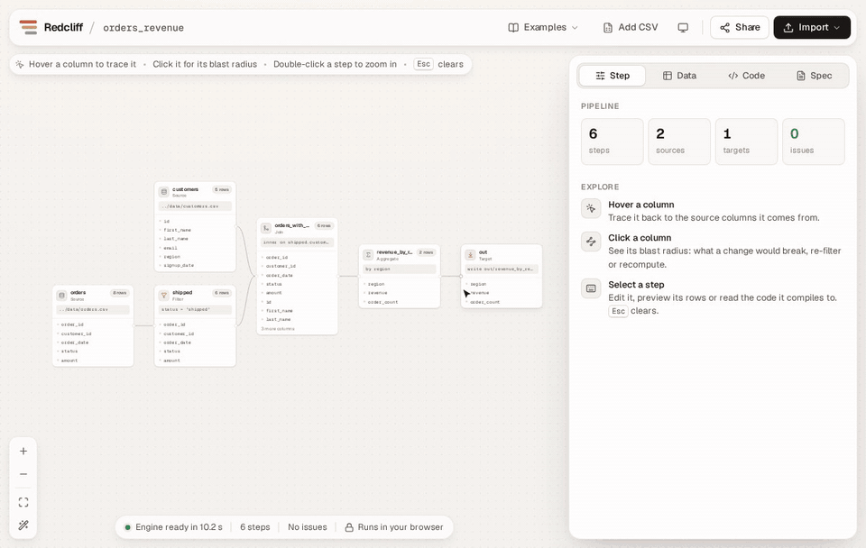
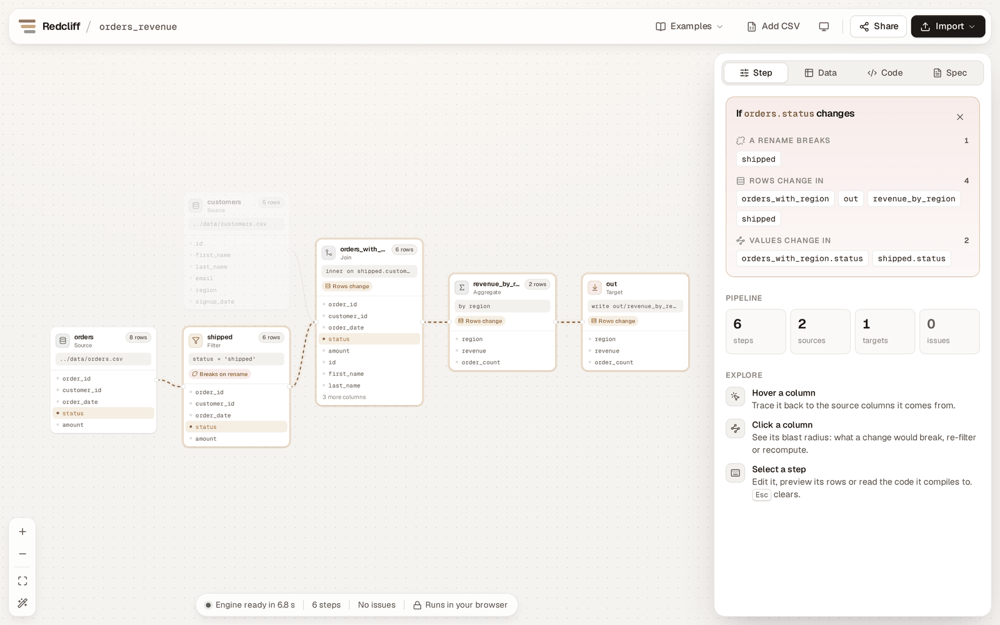
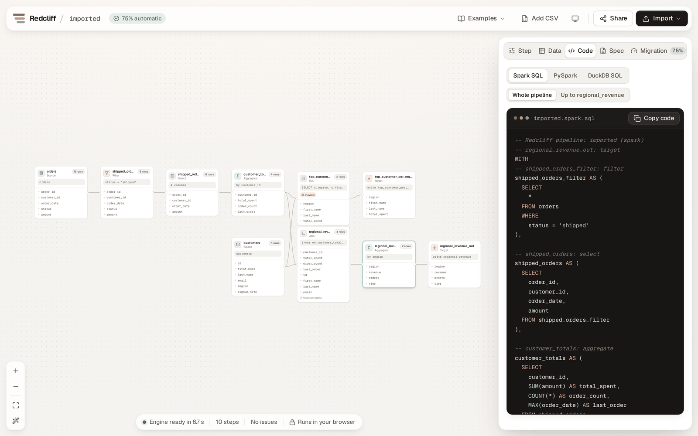
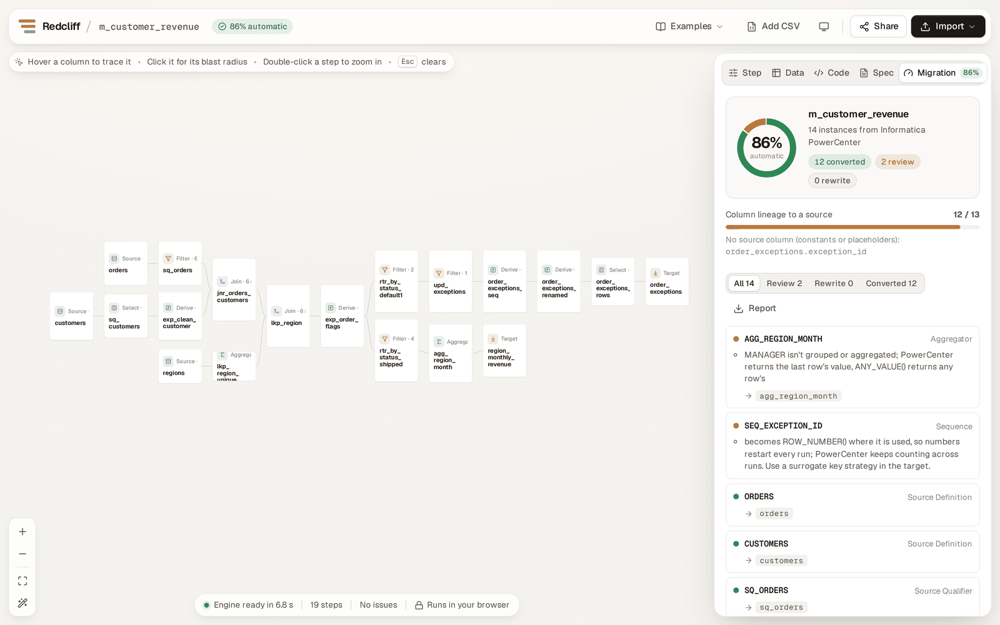

<p align="center">
  
</p>

<h1 align="center">Redcliff</h1>

<p align="center">
  <strong>Legacy ETL in, clean Spark out.</strong><br>
  Paste a 300-line Teradata job or drop in an Informatica mapping. Get a pipeline you can see,<br>
  column lineage you can trust, an honest migration scorecard, and Spark code you own.<br>
  In your browser, with nothing uploaded.
</p>

<p align="center">
  <a href="https://github.com/Fullcountr/redcliff/actions/workflows/ci.yml"></a>
  <a href="LICENSE"></a>
  
  
</p>

<p align="center">
  <a href="https://fullcountr.github.io/redcliff/"><strong>Try it live →</strong></a>
  &nbsp;·&nbsp; no install, no sign-up; your data never leaves the tab
</p>



<p align="center"><sub>Trace a column, see its blast radius, import an Informatica mapping with its migration scorecard, and read the Spark code. 30 seconds, all in the browser.</sub></p>

---

## How to read this README

A red cliff shows its history in layers, newest at the top and bedrock at the bottom. So does
this page. Stop at whichever layer answers your question:

| Layer | Read it if you want to… |
| --- | --- |
| [Surface: try it](#surface-try-it-in-a-minute) | see it work in about a minute |
| [Topsoil: what it does](#topsoil-what-redcliff-does) | know what you'd use it for |
| [Sediment: a tour of a real migration](#sediment-a-tour-of-a-real-migration) | watch a legacy job become a pipeline, step by step |
| [Strata: the pieces](#strata-the-pieces) | understand the spec, lineage and importer |
| [Bedrock: how it's built and tested](#bedrock-how-its-built-and-tested) | trust it, or contribute to it |

---

## Surface: try it in a minute

**In the browser:** open the [live playground](https://fullcountr.github.io/redcliff/). The
example pipeline is ready to explore in under a second, because its lineage, row counts and blast
radius are computed at build time. Meanwhile the engine loads in the background (Python, then
DuckDB, compiled to WebAssembly; about 15 MB gzipped, cached after the first visit). After that
everything runs in the tab and nothing is sent anywhere.

A sample pipeline loads with live row counts. Hover any column. Click one. Then press
**Import** and pick the legacy Teradata job, the Informatica PowerCenter mapping or the SSIS
package; each is already filled in.

**Run it yourself:**

```bash
git clone https://github.com/Fullcountr/redcliff.git
cd redcliff/web
npm install
npm run dev        # needs Node 20+ and Python 3 with pip (used once, to vendor the engine)
```

Then open the printed URL.

**On the command line** ([on PyPI](https://pypi.org/project/redcliff/)):

```bash
pip install "redcliff[cli]"
cd redcliff   # the clone above, for the examples
redcliff import examples/legacy/teradata_revenue.sql --dialect teradata \
  --schema examples/legacy/schema.json -o pipeline.yaml
redcliff lineage pipeline.yaml --impact orders.status
redcliff import examples/legacy/powercenter/m_customer_revenue.xml \
  -o mapping.yaml --scorecard scorecard.md
```

To work on Redcliff itself, install from the clone instead: `pip install -e "core[dev]"`.

---

## Topsoil: what Redcliff does

Redcliff turns legacy jobs, SQL scripts and Informatica mappings nobody wants to touch, into a **pipeline spec**:
a small YAML file in Git that describes each step. Everything else is generated from that spec,
so the picture, the lineage and the code can never drift apart.

<table>
<tr>
<td width="50%" valign="top">

**Import legacy SQL.** Teradata, Oracle, SQL Server, Snowflake, Redshift, BigQuery, Postgres,
MySQL, Hive, Spark and DuckDB. CTEs, joins, GROUP BY, HAVING, UNION, `CREATE TABLE AS` chains
and BTEQ scripts become steps you can read. Anything without a step type yet is kept as a SQL
step, with a note. Nothing is dropped silently.

</td>
<td width="50%" valign="top">

**Import Informatica PowerCenter and SSIS.** PowerCenter mappings and workflows, and SSIS
packages, become steps: source qualifiers, expressions, joiners, lookups, routers, ranks,
conditional splits, merge joins and more, with each expression language translated to SQL that
keeps its quirks. A **migration scorecard** grades every transformation: converted, needs review,
or rewrite by hand, with the reason.

</td>
</tr>
<tr>
<td valign="top">

**See column-level lineage.** Hover a column to trace every column that feeds it, back to the
sources. Redcliff owns the graph, so lineage is computed from the pipeline itself, not guessed
from query logs after the fact.

</td>
<td valign="top">

**Know the blast radius before you change anything.** Click a column to see which values would
change, which steps' rows would change, and which steps would break if you renamed it.

</td>
</tr>
<tr>
<td valign="top">

**Generate code you own.** Readable Spark SQL, PySpark or DuckDB SQL, one named block per step,
each with a comment; or a whole **dbt project** or **Lakeflow Declarative Pipeline**. No runtime,
no lock-in: it's your code in your repo.

</td>
<td valign="top">

**Check it on real rows.** Every step shows its row count and previews its data, computed by
DuckDB inside your browser, and runs its data quality expectations. Click a row to see exactly which source rows are behind it. Drop in
your own CSV files to try your own data. Share the whole
pipeline as a link; there is no server to store it on.

</td>
</tr>
</table>

<picture>
  <source media="(prefers-color-scheme: dark)" srcset="docs/images/blast-radius-dark.png">
  
</picture>

<p align="center"><sub>Click <code>orders.status</code>: the filter that names it would break on a rename, and every step after it would see different rows.</sub></p>

### Who it's for

- **Teams leaving legacy ETL.** Informatica PowerCenter 10.5 left standard support on March 31, 2026,
  and Teradata, Talend and Ab Initio estates are moving too. Redcliff makes the old logic visible
  and turns it into code you can review, before you commit to rewriting it.
- **Data engineers who want visual review without platform lock-in.** The output is plain Spark SQL
  and PySpark, not a proprietary runtime.
- **Anyone asked "what breaks if we change this column?"** and tired of answering by grep.

### What it is not (yet)

Redcliff is alpha software. It doesn't schedule jobs, move data or run on a cluster; it designs
pipelines and generates the code you run with your own tools. Don't point it at production
without reviewing what it generates.

---

## Sediment: a tour of a real migration

[`examples/legacy/teradata_revenue.sql`](examples/legacy/teradata_revenue.sql) is an invented,
realistic Teradata BTEQ job: `.LOGON` commands, volatile tables, `SEL`, `GROUP BY 1`, a `CASE`
over aggregates and a `QUALIFY`. Here's what Redcliff makes of it. The output below is real.

**1. Import it.**

```text
$ redcliff import teradata_revenue.sql --dialect teradata --schema schema.json -o pipeline.yaml
imported 10 nodes (2 targets) to pipeline.yaml
warning: skipped 6 BTEQ dot-command line(s)
warning: top_customer_per_region: QUALIFY kept as a SQL step
```

The two volatile tables became intermediate steps; the two `CREATE TABLE` outputs became targets.
`QUALIFY` has no step type yet, so it was kept as raw SQL and Redcliff said so.

**2. Read the spec it wrote.** Short, diffable, reviewable:

```yaml
- id: shipped_orders_filter
  type: filter
  inputs: [orders]
  params:
    condition: status = 'shipped'
- id: customer_totals
  type: aggregate
  inputs: [shipped_orders]
  params:
    group_by: [customer_id]
    measures:
      total_spent: SUM(amount)
      order_count: COUNT(*)
      last_order: MAX(order_date)
```

**3. Ask where a number comes from, and what a change would touch.**

```text
$ redcliff lineage pipeline.yaml --column regional_revenue.revenue
regional_revenue.revenue comes from:
  orders.amount  (direct, aggregation)

$ redcliff lineage pipeline.yaml --impact orders.status
If orders.status changes:
  values change in: shipped_orders_filter.status
  rows change in:   customer_totals, regional_revenue, regional_revenue_join, ... (8 steps; trimmed here)
  a rename breaks:  shipped_orders_filter
```

**4. Generate Spark SQL.** One named block per step, in pipeline order (formatting condensed here):

```sql
-- shipped_orders_filter: filter
shipped_orders_filter AS (
  SELECT * FROM orders
  WHERE status = 'shipped'
),

-- customer_totals: aggregate
customer_totals AS (
  SELECT customer_id, SUM(amount) AS total_spent, COUNT(*) AS order_count,
         MAX(order_date) AS last_order
  FROM shipped_orders
  GROUP BY customer_id
),
```

**5. Prove it computes the same answer.** `redcliff run pipeline.yaml --db warehouse.duckdb`
runs the converted job locally. The test suite runs both the original SQL and the converted
pipeline against the same data and requires identical rows.

<picture>
  <source media="(prefers-color-scheme: dark)" srcset="docs/images/imported-job-dark.png">
  
</picture>

### And an Informatica mapping

[`examples/legacy/powercenter/m_customer_revenue.xml`](examples/legacy/powercenter/m_customer_revenue.xml)
is an invented PowerCenter export: source qualifiers with a source filter, an expression with a
variable port, a master outer joiner, a lookup, a router with a DEFAULT group, an aggregator, an
update strategy and a sequence generator.

```text
$ redcliff import m_customer_revenue.xml -o pipeline.yaml --scorecard scorecard.md
imported 19 nodes (2 targets) to pipeline.yaml
warning: AGG_REGION_MONTH: MANAGER isn't grouped or aggregated; PowerCenter returns the last row's value, ANY_VALUE() returns any row's
warning: SEQ_EXCEPTION_ID: becomes ROW_NUMBER() where it is used, so numbers restart every run; PowerCenter keeps counting across runs. Use a surrogate key strategy in the target.
scorecard: 12 of 14 converted (86%), 2 to review, 0 to rewrite by hand
```

The expression `v_FIRST || ' ' || LTRIM(RTRIM(LAST_NAME))` becomes SQL that keeps PowerCenter's
habit of treating NULL as an empty string, and the steps keep the mapping's names, so a reviewer
can find `EXP_CLEAN_CUSTOMER` in both:

```yaml
- id: exp_clean_customer
  type: derive
  inputs: [sq_customers]
  params:
    columns:
      full_name: CONCAT(COALESCE(TRIM(first_name), ''), ' ', COALESCE(TRIM(last_name), ''))
      email: CASE WHEN email IS NULL OR TRIM(email) = '' THEN NULL ELSE LOWER(TRIM(email)) END
      region: CASE WHEN region IS NULL THEN 'UNKNOWN' ELSE UPPER(TRIM(region)) END
```

Lineage runs across the whole mapping, lookup included:

```text
$ redcliff lineage pipeline.yaml --column region_monthly_revenue.manager
region_monthly_revenue.manager comes from:
  regions.manager  (direct, aggregation)
```

<picture>
  <source media="(prefers-color-scheme: dark)" srcset="docs/images/scorecard-dark.png">
  
</picture>

---

## Strata: the pieces

### The pipeline spec

A pipeline is a list of steps. Nine step types cover the work:

| Step | Does | Key settings |
| --- | --- | --- |
| `source` | reads a CSV, Parquet file or table | `format`, `path` or `table`, `columns` |
| `filter` | keeps rows that match | `condition` |
| `select` | keeps and orders columns | `columns` |
| `derive` | adds or replaces columns | `columns: {name: expression}` |
| `join` | joins two inputs | `condition`, `how` |
| `aggregate` | groups and summarizes (no measures = DISTINCT) | `group_by`, `measures` |
| `union` | stacks inputs | `distinct` |
| `sql` | raw SQL for logic without a step type yet | `query` |
| `target` | writes the result | `format`, `path` or `table`, `mode` |

Expressions are plain SQL. Inside a join, each side is named by its step id. The full reference,
including the validator's rules and a JSON Schema for editor autocomplete, is in
[`docs/spec.md`](docs/spec.md).

### Lineage

Redcliff uses [OpenLineage](https://openlineage.io/)'s vocabulary, and exports to its column
lineage format:

| Kind | Meaning | Example |
| --- | --- | --- |
| Direct: identity | the value is copied | a column passed through a filter |
| Direct: transformation | the value is computed from it | `LOWER(TRIM(email))` |
| Direct: aggregation | the value summarizes it | `SUM(amount)` |
| Indirect: conditional, window | it shapes the value without being it | a `CASE` condition; a window's `PARTITION BY` |
| Indirect: filter, join, group by | it decides which rows exist | `WHERE status = 'shipped'` |

**Blast radius** follows those edges forward. A rename "breaks" a step when that step names the
column, including a same-named copy passed down from upstream.

### The SQL importer

| SQL | Becomes |
| --- | --- |
| tables in FROM and JOIN | `source` steps |
| `JOIN ... ON` and `USING`; inner, left, right, full, cross | `join` |
| `WHERE`, `HAVING` (including aggregates not in the SELECT list) | `filter` |
| `GROUP BY` (columns, positions, expressions) | `aggregate`, with a `derive` first if needed |
| computed or renamed columns | `derive`, then `select` |
| `SELECT DISTINCT` | `aggregate` with no measures |
| `UNION`, `UNION ALL` | `union` |
| CTEs and subqueries in FROM | their own chain of steps, named after the CTE |
| `CREATE TABLE AS` read later | an intermediate step |
| `CREATE TABLE AS` read by nothing, `INSERT INTO ... SELECT` | `target` |
| ORDER BY, LIMIT, QUALIFY, subqueries in WHERE, recursive CTEs | a `sql` step plus a note |

One subtle case it handles: when two joined tables share a column name and the query uses the
right-hand copy, Redcliff renames that copy before the join, so no value is lost. Details are in
[`docs/importer.md`](docs/importer.md).

### The PowerCenter importer

| PowerCenter | Becomes |
| --- | --- |
| Source Qualifier | the SQL it would run, through the SQL importer: source filter, user-defined join, foreign keys, distinct, or the SQL override itself |
| Expression | `derive`, with variable ports inlined |
| Filter, Router | `filter` (one per router group in use, DEFAULT included) |
| Aggregator | `aggregate`, including `SUM(x, condition)` |
| Joiner, connected Lookup | `join` (a lookup is de-duplicated by its keys first) |
| Union | `select` per group, then `union` |
| Sorter | nothing, or a distinct `aggregate` |
| Update Strategy | a `filter` that drops rejected rows; inserts and updates become a merge on the target's primary key |
| Sequence Generator | `ROW_NUMBER()`, flagged for review |
| Rank | a `RANK()` window and a `filter`: top or bottom N per group, ties as PowerCenter ranks them |
| Normalizer | one row per occurrence: a `select` per occurrence, then `union` |
| Mapplet | its transformations, inlined (nested mapplets too) |
| Session, parameter file, workflow, worklet | overrides applied, truncate and pre/post SQL carried to the target, `$$PARAMS` resolved, worklets expanded, run order and tasks graded |
| Java, Stored Procedure and others | a typed placeholder, flagged as manual |

The expression language (`IIF`, `DECODE`, `TO_DATE`, `ADD_TO_DATE`, `$$PARAMS` and about 50
more) is translated with PowerCenter's semantics where SQL differs. A folder export becomes one
pipeline, connected through the tables its mappings write and read. The full list is in
[`docs/powercenter.md`](docs/powercenter.md).

### The SSIS importer

SSIS packages (`.dtsx`, SSIS 2012 or later) import the same way: sources, derived columns, data
conversions, conditional splits (first true output wins, as in SSIS), sorts, merge joins, lookups,
union alls, aggregates and destinations become steps; package variables become pipeline variables;
an Execute SQL task that truncates a table makes its load overwrite; other control-flow tasks are
graded as orchestration. SSIS expressions keep their semantics, such as `+` concatenating strings
and integer division. See [`docs/ssis.md`](docs/ssis.md).

### The command line

| Command | Does |
| --- | --- |
| `redcliff import FILE.sql --dialect D [--schema S] -o pipeline.yaml` | SQL to spec |
| `redcliff import PACKAGE.dtsx [--scorecard report.md] -o pipeline.yaml` | SSIS package to spec, with a scorecard ([details](docs/ssis.md)) |
| `redcliff import EXPORT.xml [--params FILE.par] [--mapping NAME] [--scorecard report.md] -o pipeline.yaml` | PowerCenter export (mappings, mapplets, sessions, workflows) to spec, with a scorecard |
| `redcliff validate pipeline.yaml` | structure plus column-level checks |
| `redcliff compile pipeline.yaml --to spark\|pyspark\|duckdb [--node ID]` | generate code |
| `redcliff compile pipeline.yaml --to dbt\|lakeflow -o DIR` | generate a dbt project or a Lakeflow Declarative Pipeline ([details](docs/outputs.md)) |
| `redcliff lineage pipeline.yaml [--column N.C \| --impact N.C \| --openlineage N]` | lineage |
| `redcliff run pipeline.yaml [--db file.duckdb] [--node ID]` | run or preview locally with DuckDB |
| `redcliff test pipeline.yaml [--node ID]` | run the data quality expectations ([details](docs/spec.md#expectations)) |
| `redcliff trace pipeline.yaml STEP [--where COND]` | row-level trace: each row of a step with the source rows behind it |
| `redcliff diff old.yaml new.yaml [--data]` or `redcliff diff --git REF` | what a change does: steps, columns, lineage and rows ([details](docs/pr-bot.md)) |
| `redcliff mcp --root .` | an MCP server, so AI agents can read and edit pipelines, with a diff you accept first ([details](docs/mcp.md)) |

---

## Bedrock: how it's built and tested

```mermaid
flowchart LR
  canvas[Canvas] --> spec
  importer[SQL and PowerCenter<br/>importers] --> spec
  spec[(Pipeline spec<br/>YAML in Git)] --> compiler[Compiler]
  spec --> lineage[Lineage engine]
  compiler --> code[Spark SQL<br/>PySpark<br/>DuckDB SQL]
  compiler --> projects[dbt project<br/>Lakeflow pipeline]
  compiler --> preview[Preview<br/>DuckDB-Wasm]
  lineage --> graph[Column graph<br/>blast radius<br/>OpenLineage]
```

- **One source of truth.** The canvas and the importer write the spec; the compiler and lineage
  engine read it. Generated code is never parsed back.
- **Pure Python core.** `core/` depends only on [sqlglot](https://github.com/tobymao/sqlglot), so
  the same engine runs in the CLI and, through [Pyodide](https://pyodide.org/), in the browser.
- **Nothing from a CDN.** The web build vendors Pyodide, the sqlglot wheel, the engine and
  [DuckDB-Wasm](https://duckdb.org/docs/api/wasm/overview), so the app works offline and on
  any static host.
- **Interactive first, engine second.** The examples' lineage, row counts and blast radius are
  precomputed by the same Python engine at build time, so the canvas works before anything heavy
  arrives. Python loads next with the whole connection to itself, and DuckDB after it. On a
  throttled 25 Mbps connection: example interactive in 0.4 s (was 18.9 s), engine ready in
  8.9 s (was 15.1 s).

### How it's tested

| Layer | What the tests do |
| --- | --- |
| Spec | every validation rule, every example, round trips through YAML and JSON |
| Compiler | generated DuckDB SQL runs on sample data and must match rows worked out by hand |
| Lineage | each example's column map compared against one worked out by hand |
| Expectations | every check kind passes and fails on rows worked out by hand; a failing check stops `redcliff run` and fails `dbt build` |
| Row trace | tracing never changes a step's rows; every traced target row is rebuilt from only its source rows |
| Diff | step, column, lineage and row changes for edited examples, worked out by hand; `--git` mode on a scratch repository |
| MCP | the protocol over real stdio, every tool, and edits: proposed without writing, applied once, refused when stale or broken, untouched steps kept byte for byte |
| Importer | the original SQL and the imported, recompiled pipeline must return identical rows |
| PowerCenter | the sample mapping runs in DuckDB and must match rows worked out by hand; the same job rebuilt with a mapplet, session, workflow and parameter file must return identical rows; a store mart with a Normalizer, two Ranks (a tie, a NULL) and a worklet matches rows worked out by hand; every transformation type and scorecard status has a test |
| Expressions | each Informatica and SSIS expression runs in DuckDB and must return the original tool's answer |
| SSIS | the sample package runs in DuckDB, Spark, dbt and Lakeflow and must match rows worked out by hand; each component type, including first-match conditional splits and lookup no-match outputs, has a test |
| CLI | a legacy Teradata job goes through import, validate, compile, lineage and run |
| Spark | generated Spark SQL and PySpark run on real Spark and must match DuckDB, row for row; Informatica expressions too |
| dbt | every example becomes a dbt project, `dbt build` runs it with dbt-duckdb (seeds, hooks, file targets) and every target must match DuckDB |
| Lakeflow | every example becomes a Lakeflow Declarative Pipeline, `spark-pipelines run` runs it on local Spark and every materialized view must match DuckDB |
| Browser | headless Chromium drives the real app: boot, hover, blast radius, SQL and PowerCenter import, scorecard, preview, edit, share, phone layout; after every deploy it runs again against the live site |

CI runs all of it on every push, including the browser test and a real Spark: the generated
Spark SQL (queries and full scripts that write tables) and PySpark scripts run on a local Spark 4
with its defaults, ANSI mode included, and must return DuckDB's rows for every example, the
imported Teradata job and the imported PowerCenter exports.

### Repository layout

| Folder | What's in it |
| --- | --- |
| [`core/`](core) | the Python package: spec, compiler, lineage, row trace, diff, importers, CLI, MCP server, browser bridge |
| [`web/`](web) | the playground: React, React Flow, Pyodide worker, DuckDB-Wasm |
| [`examples/`](examples) | sample data, example pipelines, a legacy Teradata job, three PowerCenter exports and an SSIS package |
| [`docs/`](docs) | spec reference, architecture notes, importer guides (SQL, PowerCenter, SSIS), outputs, the pull request bot, the MCP server, releasing |
| [`action.yml`](action.yml) | the pull request bot as a GitHub Action |
| [`spikes/`](spikes) | small experiments that proved an approach |

---

## How it compares

Visual design that generates real code is a proven idea. Redcliff's angle is doing it in the open.

| | Open source | Runs where | Legacy SQL import | Column lineage built in |
| --- | --- | --- | --- | --- |
| **Redcliff** | yes, Apache 2.0 | anywhere; generates Spark SQL, PySpark, DuckDB SQL, dbt, Lakeflow | yes: 11 SQL dialects, Informatica PowerCenter and SSIS | yes |
| Prophecy | no | Spark and SQL platforms | yes, including Ab Initio (paid) | yes |
| Databricks Lakeflow Designer | no | Databricks | no | through Unity Catalog |
| dbt Canvas | no | dbt platform, Enterprise plans | no | through dbt |
| Coalesce | no | cloud warehouses | no | yes |
| Apache Hop | yes, Apache 2.0 | Hop engine, or Beam on Spark, Flink, Dataflow | no | – |
| Databricks Lakebridge | partly (converters are free but closed) | Databricks | yes | – |

<sub>As of October 2026, from public docs. – means not a core feature as far as we know. Corrections welcome by pull request.</sub>

---

## Roadmap

- [x] Pipeline spec, validator and JSON Schema
- [x] Compiler to DuckDB SQL, Spark SQL and PySpark
- [x] Column-level lineage, blast radius and OpenLineage export
- [x] SQL importer for 11 dialects, with BTEQ support
- [x] Command line
- [x] Browser playground with previews and share links
- [x] Informatica PowerCenter XML importer, with a migration scorecard
- [x] Mapplet expansion and session/workflow import (pre/post SQL, parameter files)
- [x] PowerCenter Rank, Normalizer and worklets
- [x] Spark SQL and PySpark run against real Spark in CI
- [x] dbt and Lakeflow pipeline outputs, both run in CI
- [x] Row-level trace: click an output row, see the input rows behind it
- [x] MCP server, so AI agents can edit pipelines and show a diff before you accept
- [x] Pull request bot: lineage and data diffs posted on every PR ([`uses: Fullcountr/redcliff@main`](docs/pr-bot.md))
- [x] Pipeline variables: `${name}` with defaults, `--var` overrides and a Variables bar in the playground; PowerCenter `$$PARAMS` import as variables, dbt gets `var()`
- [x] Merge targets (`mode: merge` with `keys` and `delete_when`); PowerCenter Update Strategy upserts import as merges
- [x] Data quality expectations on any step: `redcliff test`, results on the canvas, dbt tests and Lakeflow expectations
- [x] SSIS package (`.dtsx`) importer, with a scorecard
- [x] `pip install redcliff` from PyPI, released by a tag-triggered workflow

### Next

- [ ] VS Code extension: the canvas and lineage next to the spec file
- [ ] OpenLineage run events from `redcliff run`, so a catalog such as Marquez sees each run with its column lineage
- [ ] Talend and IBM DataStage importers
- [ ] A side-by-side diff view in the playground, the same report the pull request bot posts

---

## FAQ

**Does my SQL or data leave my machine?**
No. The playground runs Python and DuckDB inside your browser tab. Share links carry the
pipeline in the URL itself; there is no server to send it to.

**Can I use it on a real migration today?**
Use it to understand, document and draft. Review the generated code before running it anywhere
that matters; this is alpha software.

**Why Python in the browser instead of JavaScript?**
So there is exactly one engine. The CLI, the tests and the playground all run the same code.

**How honest is the migration scorecard?**
It only says "converted" when the generated SQL means the same thing. Anything that differs in
an edge case (row order, NULL handling, values carried across runs) is "review", with the reason.
Anything with no translation yet is "manual" and gets a typed placeholder, never a silent drop.

**My SQL or mapping didn't import cleanly.**
Please [open an issue](https://github.com/Fullcountr/redcliff/issues) with a small, invented
example that shows the problem. Never share an employer's or client's real code or mappings.

---

## Contributing

Bug reports with small SQL examples are the most useful contribution right now. See
[CONTRIBUTING.md](CONTRIBUTING.md). The one hard rule: **clean room only**. No code, schemas
or data that belong to an employer or a client.

## Thanks

Redcliff stands on [sqlglot](https://github.com/tobymao/sqlglot) for parsing and transpiling,
[DuckDB](https://duckdb.org/) for previews, [Pyodide](https://pyodide.org/) for Python in the
browser, [React Flow](https://reactflow.dev/) for the canvas and
[OpenLineage](https://openlineage.io/) for the lineage vocabulary.

## License

[Apache License 2.0](LICENSE).
