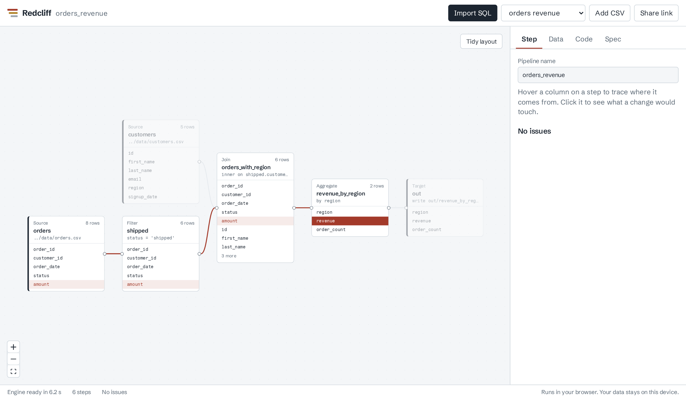
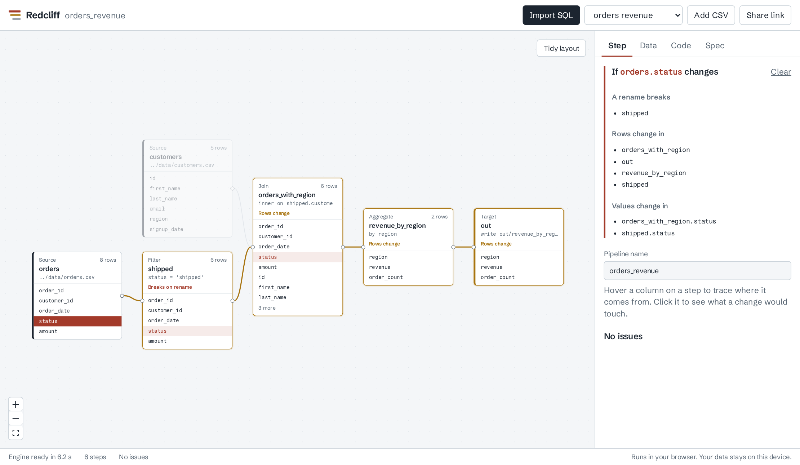
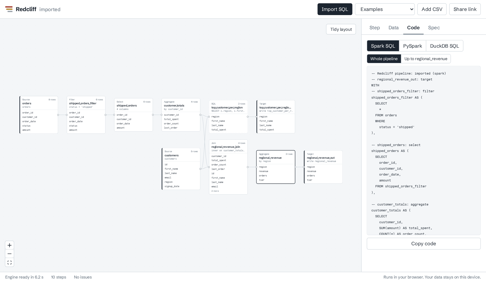

<p align="center">
  
</p>

<h1 align="center">Redcliff</h1>

<p align="center">
  <strong>Legacy ETL in, clean Spark out.</strong><br>
  Paste a 300-line Teradata job. Get a pipeline you can see, column lineage you can trust,<br>
  and Spark code you own. In your browser, with nothing uploaded.
</p>

<p align="center">
  <a href="https://github.com/Fullcountr/redcliff/actions/workflows/ci.yml"></a>
  <a href="LICENSE"></a>
  
  
</p>

<picture>
  <source media="(prefers-color-scheme: dark)" srcset="docs/images/trace-dark.png">
  
</picture>

<p align="center"><sub>Hover <code>revenue</code> and Redcliff traces it back to <code>orders.amount</code>, through the aggregate, the join and the filter. Everything else fades.</sub></p>

---

## How to read this README

A red cliff shows its history in layers, newest at the top and bedrock at the bottom. So does
this page. Stop at whichever layer answers your question:

| Layer | Read it if you want to… |
| --- | --- |
| [Surface: try it](#surface-try-it-in-a-minute) | see it work in about a minute |
| [Topsoil: what it does](#topsoil-what-redcliff-does) | know what you'd use it for |
| [Sediment: a tour of a real migration](#sediment-a-tour-of-a-real-migration) | watch a legacy job become a pipeline, step by step |
| [Strata: the pieces](#strata-the-pieces) | understand the spec, lineage and importer |
| [Bedrock: how it's built and tested](#bedrock-how-its-built-and-tested) | trust it, or contribute to it |

---

## Surface: try it in a minute

**In the browser** (the whole engine runs locally; nothing is sent anywhere):

```bash
git clone https://github.com/Fullcountr/redcliff.git
cd redcliff/web
npm install
npm run dev        # needs Node 20+ and Python 3 with pip (used once, to vendor the engine)
```

Open the printed URL. A sample pipeline loads with live row counts. Hover any column. Click one.
Then press **Import SQL** and import the legacy Teradata job that's already filled in.

**On the command line:**

```bash
cd redcliff/core
pip install -e ".[cli]"
redcliff import ../examples/legacy/teradata_revenue.sql --dialect teradata \
  --schema ../examples/legacy/schema.json -o pipeline.yaml
redcliff lineage pipeline.yaml --impact orders.status
```

---

## Topsoil: what Redcliff does

Redcliff turns SQL, including the legacy kind nobody wants to touch, into a **pipeline spec**:
a small YAML file in Git that describes each step. Everything else is generated from that spec,
so the picture, the lineage and the code can never drift apart.

<table>
<tr>
<td width="50%" valign="top">

**Import legacy SQL.** Teradata, Oracle, SQL Server, Snowflake, Redshift, BigQuery, Postgres,
MySQL, Hive, Spark and DuckDB. CTEs, joins, GROUP BY, HAVING, UNION, `CREATE TABLE AS` chains
and BTEQ scripts become steps you can read. Anything without a step type yet is kept as a SQL
step, with a note. Nothing is dropped silently.

</td>
<td width="50%" valign="top">

**See column-level lineage.** Hover a column to trace every column that feeds it, back to the
sources. Redcliff owns the graph, so lineage is computed from the pipeline itself, not guessed
from query logs after the fact.

</td>
</tr>
<tr>
<td valign="top">

**Know the blast radius before you change anything.** Click a column to see which values would
change, which steps' rows would change, and which steps would break if you renamed it.

</td>
<td valign="top">

**Generate code you own.** Readable Spark SQL, PySpark or DuckDB SQL, one named block per step,
each with a comment. No runtime, no lock-in: it's your code in your repo.

</td>
</tr>
<tr>
<td valign="top">

**Check it on real rows.** Every step shows its row count and previews its data, computed by
DuckDB inside your browser. Drop in your own CSV files to try your own data.

</td>
<td valign="top">

**Share it as a link.** The whole pipeline is compressed into the URL. Whoever opens it sees the
same graph, lineage and code. Nothing is stored on a server, because there is no server.

</td>
</tr>
</table>



<p align="center"><sub>Click <code>orders.status</code>: the filter that names it would break on a rename, and every step after it would see different rows.</sub></p>

### Who it's for

- **Teams leaving legacy ETL.** Informatica PowerCenter 10.5 left standard support on March 31, 2026,
  and Teradata, Talend and Ab Initio estates are moving too. Redcliff makes the old logic visible
  and turns it into code you can review, before you commit to rewriting it.
- **Data engineers who want visual review without platform lock-in.** The output is plain Spark SQL
  and PySpark, not a proprietary runtime.
- **Anyone asked "what breaks if we change this column?"** and tired of answering by grep.

### What it is not (yet)

Redcliff is alpha software. It doesn't schedule jobs, move data or run on a cluster; it designs
pipelines and generates the code you run with your own tools. Don't point it at production
without reviewing what it generates.

---

## Sediment: a tour of a real migration

[`examples/legacy/teradata_revenue.sql`](examples/legacy/teradata_revenue.sql) is an invented,
realistic Teradata BTEQ job: `.LOGON` commands, volatile tables, `SEL`, `GROUP BY 1`, a `CASE`
over aggregates and a `QUALIFY`. Here's what Redcliff makes of it. The output below is real.

**1. Import it.**

```text
$ redcliff import teradata_revenue.sql --dialect teradata --schema schema.json -o pipeline.yaml
imported 10 nodes (2 targets) to pipeline.yaml
warning: skipped 6 BTEQ dot-command line(s)
warning: top_customer_per_region: QUALIFY kept as a SQL step
```

The two volatile tables became intermediate steps; the two `CREATE TABLE` outputs became targets.
`QUALIFY` has no step type yet, so it was kept as raw SQL and Redcliff said so.

**2. Read the spec it wrote.** Short, diffable, reviewable:

```yaml
- id: shipped_orders_filter
  type: filter
  inputs: [orders]
  params:
    condition: status = 'shipped'
- id: customer_totals
  type: aggregate
  inputs: [shipped_orders]
  params:
    group_by: [customer_id]
    measures:
      total_spent: SUM(amount)
      order_count: COUNT(*)
      last_order: MAX(order_date)
```

**3. Ask where a number comes from, and what a change would touch.**

```text
$ redcliff lineage pipeline.yaml --column regional_revenue.revenue
regional_revenue.revenue comes from:
  orders.amount  (direct, aggregation)

$ redcliff lineage pipeline.yaml --impact orders.status
If orders.status changes:
  values change in: shipped_orders_filter.status
  rows change in:   customer_totals, regional_revenue, regional_revenue_join, ... (8 steps; trimmed here)
  a rename breaks:  shipped_orders_filter
```

**4. Generate Spark SQL.** One named block per step, in pipeline order (formatting condensed here):

```sql
-- shipped_orders_filter: filter
shipped_orders_filter AS (
  SELECT * FROM orders
  WHERE status = 'shipped'
),

-- customer_totals: aggregate
customer_totals AS (
  SELECT customer_id, SUM(amount) AS total_spent, COUNT(*) AS order_count,
         MAX(order_date) AS last_order
  FROM shipped_orders
  GROUP BY customer_id
),
```

**5. Prove it computes the same answer.** `redcliff run pipeline.yaml --db warehouse.duckdb`
runs the converted job locally. The test suite runs both the original SQL and the converted
pipeline against the same data and requires identical rows.



---

## Strata: the pieces

### The pipeline spec

A pipeline is a list of steps. Nine step types cover the work:

| Step | Does | Key settings |
| --- | --- | --- |
| `source` | reads a CSV, Parquet file or table | `format`, `path` or `table`, `columns` |
| `filter` | keeps rows that match | `condition` |
| `select` | keeps and orders columns | `columns` |
| `derive` | adds or replaces columns | `columns: {name: expression}` |
| `join` | joins two inputs | `condition`, `how` |
| `aggregate` | groups and summarizes (no measures = DISTINCT) | `group_by`, `measures` |
| `union` | stacks inputs | `distinct` |
| `sql` | raw SQL for logic without a step type yet | `query` |
| `target` | writes the result | `format`, `path` or `table`, `mode` |

Expressions are plain SQL. Inside a join, each side is named by its step id. The full reference,
including the validator's rules and a JSON Schema for editor autocomplete, is in
[`docs/spec.md`](docs/spec.md).

### Lineage

Redcliff uses [OpenLineage](https://openlineage.io/)'s vocabulary, and exports to its column
lineage format:

| Kind | Meaning | Example |
| --- | --- | --- |
| Direct: identity | the value is copied | a column passed through a filter |
| Direct: transformation | the value is computed from it | `LOWER(TRIM(email))` |
| Direct: aggregation | the value summarizes it | `SUM(amount)` |
| Indirect: conditional, window | it shapes the value without being it | a `CASE` condition; a window's `PARTITION BY` |
| Indirect: filter, join, group by | it decides which rows exist | `WHERE status = 'shipped'` |

**Blast radius** follows those edges forward. A rename "breaks" a step when that step names the
column, including a same-named copy passed down from upstream.

### The SQL importer

| SQL | Becomes |
| --- | --- |
| tables in FROM and JOIN | `source` steps |
| `JOIN ... ON` and `USING`; inner, left, right, full, cross | `join` |
| `WHERE`, `HAVING` (including aggregates not in the SELECT list) | `filter` |
| `GROUP BY` (columns, positions, expressions) | `aggregate`, with a `derive` first if needed |
| computed or renamed columns | `derive`, then `select` |
| `SELECT DISTINCT` | `aggregate` with no measures |
| `UNION`, `UNION ALL` | `union` |
| CTEs and subqueries in FROM | their own chain of steps, named after the CTE |
| `CREATE TABLE AS` read later | an intermediate step |
| `CREATE TABLE AS` read by nothing, `INSERT INTO ... SELECT` | `target` |
| ORDER BY, LIMIT, QUALIFY, subqueries in WHERE, recursive CTEs | a `sql` step plus a note |

One subtle case it handles: when two joined tables share a column name and the query uses the
right-hand copy, Redcliff renames that copy before the join, so no value is lost. Details are in
[`docs/importer.md`](docs/importer.md).

### The command line

| Command | Does |
| --- | --- |
| `redcliff import FILE.sql --dialect D [--schema S] -o pipeline.yaml` | SQL to spec |
| `redcliff validate pipeline.yaml` | structure plus column-level checks |
| `redcliff compile pipeline.yaml --to spark\|pyspark\|duckdb [--node ID]` | generate code |
| `redcliff lineage pipeline.yaml [--column N.C \| --impact N.C \| --openlineage N]` | lineage |
| `redcliff run pipeline.yaml [--db file.duckdb] [--node ID]` | run or preview locally with DuckDB |

---

## Bedrock: how it's built and tested

```mermaid
flowchart LR
  canvas[Canvas] --> spec
  importer[SQL importer] --> spec
  spec[(Pipeline spec<br/>YAML in Git)] --> compiler[Compiler]
  spec --> lineage[Lineage engine]
  compiler --> code[Spark SQL<br/>PySpark<br/>DuckDB SQL]
  compiler --> preview[Preview<br/>DuckDB-Wasm]
  lineage --> graph[Column graph<br/>blast radius<br/>OpenLineage]
```

- **One source of truth.** The canvas and the importer write the spec; the compiler and lineage
  engine read it. Generated code is never parsed back.
- **Pure Python core.** `core/` depends only on [sqlglot](https://github.com/tobymao/sqlglot), so
  the same engine runs in the CLI and, through [Pyodide](https://pyodide.org/), in the browser.
- **Nothing from a CDN.** The web build vendors Pyodide, the sqlglot wheel, the engine and
  [DuckDB-Wasm](https://duckdb.org/docs/api/wasm/overview), so the app works offline and on
  any static host. The engine starts in about 5 seconds, once.

### How it's tested

| Layer | What the tests do |
| --- | --- |
| Spec | every validation rule, every example, round trips through YAML and JSON |
| Compiler | generated DuckDB SQL runs on sample data and must match rows worked out by hand |
| Lineage | each example's column map compared against one worked out by hand |
| Importer | the original SQL and the imported, recompiled pipeline must return identical rows |
| CLI | a legacy Teradata job goes through import, validate, compile, lineage and run |
| Browser | headless Chromium drives the real app: boot, hover, blast radius, import, preview, edit, share, phone layout |

CI runs all of it, including the browser test, on every push. Spark SQL is checked by parsing
and PySpark by compiling; running them against a real Spark cluster is on the roadmap.

### Repository layout

| Folder | What's in it |
| --- | --- |
| [`core/`](core) | the Python package: spec, compiler, lineage, importer, CLI, browser bridge |
| [`web/`](web) | the playground: React, React Flow, Pyodide worker, DuckDB-Wasm |
| [`examples/`](examples) | sample data, example pipelines and the legacy Teradata job |
| [`docs/`](docs) | spec reference, architecture notes, importer guide |
| [`spikes/`](spikes) | small experiments that proved an approach |

---

## How it compares

Visual design that generates real code is a proven idea. Redcliff's angle is doing it in the open.

| | Open source | Runs where | Legacy SQL import | Column lineage built in |
| --- | --- | --- | --- | --- |
| **Redcliff** | yes, Apache 2.0 | anywhere; generates Spark SQL, PySpark, DuckDB SQL | yes, 11 dialects | yes |
| Prophecy | no | Spark and SQL platforms | yes, including Ab Initio (paid) | yes |
| Databricks Lakeflow Designer | no | Databricks | no | through Unity Catalog |
| dbt Canvas | no | dbt platform, Enterprise plans | no | through dbt |
| Coalesce | no | cloud warehouses | no | yes |
| Apache Hop | yes, Apache 2.0 | Hop engine, or Beam on Spark, Flink, Dataflow | no | – |
| Databricks Lakebridge | partly (converters are free but closed) | Databricks | yes | – |

<sub>As of October 2026, from public docs. – means not a core feature as far as we know. Corrections welcome by pull request.</sub>

---

## Roadmap

- [x] Pipeline spec, validator and JSON Schema
- [x] Compiler to DuckDB SQL, Spark SQL and PySpark
- [x] Column-level lineage, blast radius and OpenLineage export
- [x] SQL importer for 11 dialects, with BTEQ support
- [x] Command line
- [x] Browser playground with previews and share links
- [ ] Informatica PowerCenter XML importer, with a migration scorecard
- [ ] Spark SQL and PySpark run against real Spark in CI
- [ ] Row-level trace: click an output row, see the input rows behind it
- [ ] MCP server, so AI agents can edit pipelines and show a diff before you accept
- [ ] Pull request bot: lineage and data diffs posted on every PR
- [ ] dbt and Lakeflow pipeline outputs

---

## FAQ

**Does my SQL or data leave my machine?**
No. The playground runs Python and DuckDB inside your browser tab. Share links carry the
pipeline in the URL itself; there is no server to send it to.

**Can I use it on a real migration today?**
Use it to understand, document and draft. Review the generated code before running it anywhere
that matters; this is alpha software.

**Why Python in the browser instead of JavaScript?**
So there is exactly one engine. The CLI, the tests and the playground all run the same code.

**My SQL didn't import cleanly.**
Please [open an issue](https://github.com/Fullcountr/redcliff/issues) with a small,
anonymized example. Never share an employer's or client's real code.

---

## Contributing

Bug reports with small SQL examples are the most useful contribution right now. See
[CONTRIBUTING.md](CONTRIBUTING.md). The one hard rule: **clean room only**. No code, schemas
or data that belong to an employer or a client.

## Thanks

Redcliff stands on [sqlglot](https://github.com/tobymao/sqlglot) for parsing and transpiling,
[DuckDB](https://duckdb.org/) for previews, [Pyodide](https://pyodide.org/) for Python in the
browser, [React Flow](https://reactflow.dev/) for the canvas and
[OpenLineage](https://openlineage.io/) for the lineage vocabulary.

## License

[Apache License 2.0](LICENSE).
